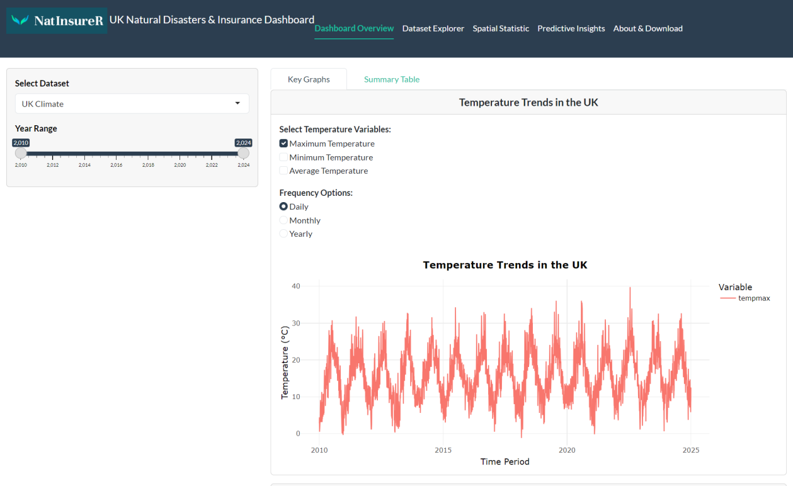

# NatInsureR

An R Shiny dissertation prototype exploring UK natural disasters, climate patterns and simulated insurance claims.

**[Open the live dashboard](https://tejeshrameshbawa.shinyapps.io/NatInsureR/)** · **[Read the MSc dissertation](dissertation.pdf)**

## Project question

How can an interactive dashboard combine disaster, climate and claims information to explore regional patterns and compare approaches to claims prediction?

## What I built

- An R Shiny interface with Dashboard Overview, Dataset Explorer, Spatial Statistics, Predictive Insights and About & Download modules.
- Interactive filtering and visual exploration across four dataset groups: natural disasters, UK climate, county climate and insurance claims.
- Spatial analysis using Moran's I and scatterplots to examine clustering in claims and residuals.
- Comparisons of generalised linear models and XGBoost, using Poisson objectives for counts and Tweedie approaches for amounts.
- Scenario controls for exploring changes in model inputs and communicating forecasting limits.

## Findings and interpretation

The dissertation describes a trade-off: GLMs captured some spikes more effectively, while XGBoost produced steadier forecasts in zero-heavy data but still struggled with extremes. These are prototype findings rather than independently validated insurance pricing or underwriting performance.

**The insurance claims are simulated.** The project demonstrates analytical and dashboard methods; it does not establish performance on real insurer claims. Scenario outputs are model experiments, not predictions of actual future losses.

## Explore the portfolio

- [Live R Shiny dashboard](https://tejeshrameshbawa.shinyapps.io/NatInsureR/)
- [MSc dissertation](dissertation.pdf), submitted September 2025
- [Claims analysis preview](claims-preview.png)
- [Predictive insights preview](predictive-preview.png)

The screenshots are figures from the dissertation and may differ from the live deployment. This repository presents the report and visual evidence. Application source code, trained model artefacts and input datasets are not bundled here, so it is not a standalone local installation package.

## Tools and context

R · R Shiny · exploratory data analysis · spatial statistics · GLM · XGBoost · predictive modelling · data storytelling

MSc Data Science (FinTech), University of Greenwich. Project by Tejesh Ramesh Bawa. The public dissertation copy omits the student identifier.
